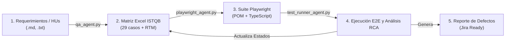

# Ecosistema QA Integral: De Requerimientos a Reporte de Defectos

Bienvenido al ecosistema integral de ingeniería de calidad de software (**QA Ecosystem**), compuesto por una **trilogía de agentes autónomos y especializados**:

1. **Agente 1: Diseñador QA ISTQB (`qa_agent.py`)**  
   Analiza especificaciones de requerimientos (SRS, historias de usuario, reglas de negocio), aplica técnicas formales de caja negra (**ISTQB CTFL v4.0 / ISO/IEC/IEEE 29119**) y genera un libro de cálculo profesional en **Microsoft Excel (.xlsx)** con métricas ejecutivas, casos de prueba detallados y matriz de trazabilidad (RTM).
2. **Agente 2: Automatizador QA Playwright (`playwright_agent.py`)**  
   Toma los casos de prueba (Excel ISTQB, Markdown o JSON) y genera una suite de automatización E2E completa en **Playwright (TypeScript)** con patrón **Page Object Model (POM)**, selectores semánticos y fixtures tipados.
3. **Agente 3: Ejecutor y Gestor de Defectos QA (`test_runner_agent.py`)**  
   Ejecuta la suite de pruebas de Playwright, gestiona el entorno web local, captura fallos en tiempo real, aplica **Análisis de Causa Raíz (RCA)**, genera un **Reporte de Defectos listo para Jira/GitHub** y **actualiza automáticamente el libro Excel ISTQB** con los estados de ejecución (`Pasó` / `Falló`), fechas y notas técnicas.

---

## 🏛️ Pipeline Completo del Ciclo de Vida de Pruebas



---

## 📂 Estructura del Proyecto

```
d:\workspace\agentic/
├── qa_agent.py                          # Agente 1: Analizador de requerimientos y generador Excel ISTQB
├── playwright_agent.py                  # Agente 2: Generador de suite de automatización Playwright
├── test_runner_agent.py                 # Agente 3: Ejecutor de pruebas, análisis RCA y reporte de defectos
├── ejemplo_requerimientos.md            # Especificación funcional de ejemplo
├── Casos_de_Prueba_ISTQB_Ejemplo.xlsx   # Matriz Excel ISTQB (actualizada dinámicamente tras la ejecución)
├── Reporte_Ejecucion_Defectos.md        # Informe de resultados y tickets de defectos para Jira
├── package.json                         # Dependencias y scripts de orquestación npm
├── playwright-suite/                    # Suite de Playwright generada
│   ├── playwright.config.ts             # Configuración multi-navegador y servidor web
│   ├── tsconfig.json                    # Configuración TypeScript
│   ├── pages/                           # Clases Page Object Model (POM)
│   ├── tests/                           # 29 Casos de prueba automatizados (.spec.ts)
│   ├── fixtures/                        # Datos de prueba tipados (testData.ts)
│   └── mock-app/                        # Entorno de pruebas web local (SPA fallback)
├── .agents/skills/                      # Habilidades registradas en el ecosistema Antigravity
│   ├── qa-istqb-generator/SKILL.md
│   ├── qa-playwright-generator/SKILL.md
│   └── qa-test-runner/SKILL.md
└── README.md
```

---

## 🚀 Comandos de Operación

### 1. Ejecutar el ciclo de vida completo (End-to-End):
```powershell
cmd /c "npm run qa:end-to-end"
```
*(Analiza requerimientos $\to$ Genera Excel $\to$ Diseña suite Playwright $\to$ Ejecuta pruebas $\to$ Actualiza Excel $\to$ Emite reporte de defectos).*

### 2. Ejecutar solo el Agente de Pruebas y Defectos:
```powershell
cmd /c "npm run qa:run-tests"
```

### 3. Filtrar ejecución por caso de prueba específico:
```powershell
python test_runner_agent.py --filter "TC_RF_003"
```
